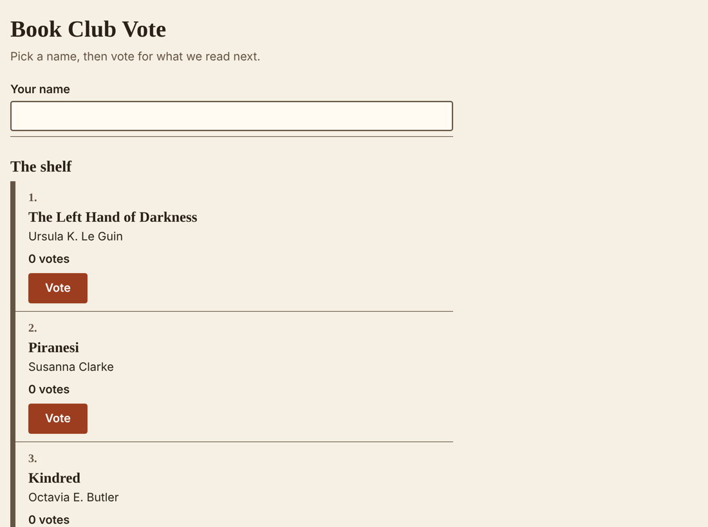

# Example runs

This page lists real Tinkerhall runs: the exact request, the Claude Code version,
how long it took, whether the app ran without human fixes, and what failed.
Numbers here only ever come from real runs; nothing is estimated or invented.

Want to add yours? Open an issue with the "Example run" template.

| Request | Date | Claude Code version | Time | Ran without fixes? | What failed along the way | Who ran it |
| --- | --- | --- | --- | --- | --- | --- |
| Book club voting page (below) | 2026-11-27 | 2.1.332 | about 15 min | Yes | 1 Tester failure (empty-name message not visible), fixed on first retry. Reviewer found 2 crash bugs, both fixed | Maintainer test, headless |

## Book club voting page

**Request:**

```text
/studio:start A page where my book club can list books we want to read and vote on the next one.
For your questions: defaults are fine. I approve the brief and the design as you write them,
so please continue through every stage to the hand over without stopping for my approval.
```

The approvals were given up front because this was a headless test run. In
normal use you approve the brief and design yourself.

**Result:** a Node 22 app with no dependencies (`node server.js`), saving to a
local JSON file. 31 automated tests pass, and the Tester also checked it in a
headless browser. The maintainer re-ran the tests and started the server
independently afterwards: 31 of 31 passed and the page loaded.

**What went wrong and was fixed:**

- Slice 6: clicking Vote without a name showed no visible message. Fixed on the first retry.
- Review: a URL containing `%00` crashed the server, and so did a hand-edited data
  file. Both fixed, plus protection against other websites posting to the list.

**Honestly not checked:** a real screen reader, a full keyboard-only walk
through, and the reduced-motion setting.


